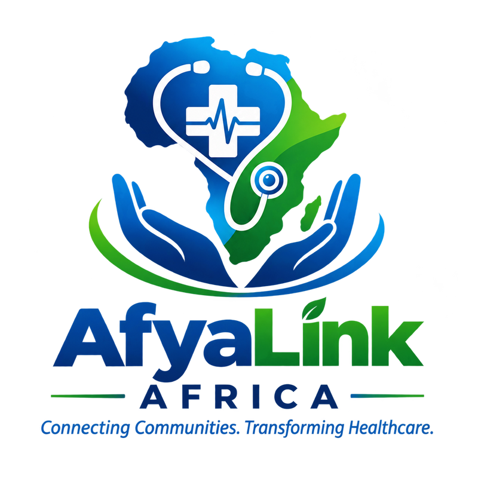

<div align="center">



<h1>AfyaLink Africa</h1>

<h3>Open-source community health technology for Africa</h3>

<p><strong>Connecting communities. Transforming healthcare.</strong></p>

<p>
<a href="https://github.com/AfyaLinkAfrica/afyalink-web/actions/workflows/ci.yml"></a>


<a href="https://github.com/AfyaLinkAfrica/afyalink-web/labels/good%20first%20issue"></a>

</p>

<p>
<a href="CONTRIBUTING.md">Contribute</a> ·
<a href="https://github.com/AfyaLinkAfrica/afyalink-web/issues">Issues</a> ·
<a href="https://github.com/AfyaLinkAfrica/afyalink-web/discussions">Discussions</a> ·
<a href="mailto:dantechdevs@gmail.com">Contact</a>
</p>

</div>

> **Status:** Early development. The Laravel foundation, Facility model, and CI are in place. The directory pages are being built. See the open issues to get involved.

**AfyaLink Africa** is an open-source community health technology initiative dedicated to improving access to reliable health information and healthcare services through technology and global collaboration.

Founded by **Dantechdevs Developers**, the project aims to bring together software developers, healthcare professionals, public health researchers, designers, and community organizations to build accessible digital health solutions for underserved communities.

Our journey begins in Kenya, with a long-term vision of expanding across Africa and beyond.

> **Our mission:** To make reliable health information and healthcare services more accessible through inclusive, secure, and community-driven technology.

---

## 🚀 Your First Contribution in 10 Minutes

Pick a [good first issue](https://github.com/AfyaLinkAfrica/afyalink-web/labels/good%20first%20issue), then:

```bash
git clone https://github.com/<your-username>/afyalink-web.git
cd afyalink-web
composer install
cp .env.example .env
php artisan key:generate
php artisan migrate --seed
php artisan test
```

Create a branch, make your change, run `./vendor/bin/pint`, and open a pull request. Use **synthetic data only**. Never commit real patient information. Read [CONTRIBUTING.md](CONTRIBUTING.md) for the full guide.

---

## 📌 Table of Contents

- [About the Project](#-about-the-project)
- [The Problem We Want to Solve](#-the-problem-we-want-to-solve)
- [Our Vision](#-our-vision)
- [Our Mission](#-our-mission)
- [Core Features](#-core-features)
- [Who We Serve](#-who-we-serve)
- [Technology Stack](#-technology-stack)
- [Project Roadmap](#-project-roadmap)
- [Getting Started](#-getting-started)
- [Project Structure](#-project-structure)
- [Open-Source Collaboration](#-open-source-collaboration)
- [Health Information and Safety](#-health-information-and-safety)
- [Privacy and Security](#-privacy-and-security)
- [How to Contribute](#-how-to-contribute)
- [Our Founding Team](#-our-founding-team)
- [Contact](#-contact)
- [License](#-license)
- [Join the Movement](#-join-the-movement)

---

## 🩺 About the Project

Access to reliable health information and healthcare services remains a challenge for many communities.

People may struggle to find nearby healthcare facilities, obtain trustworthy health education, remember scheduled appointments, or access community health programs.

AfyaLink Africa aims to address these challenges through a practical, accessible, and community-focused digital platform.

We believe technology can help communities make better-informed decisions about seeking healthcare while supporting the work of healthcare professionals and community organizations.

We are building this initiative as an open-source collaboration so that contributors around the world can help improve the technology and adapt it to local needs.

**AfyaLink Africa is a community health support initiative, not a replacement for hospitals, healthcare professionals, or official health information systems.**

## 🎯 The Problem We Want to Solve

Our initial work will explore several challenges:

- Difficulty finding accurate information about healthcare facilities and their services.
- Limited access to reliable health education in local languages.
- Challenges keeping track of scheduled healthcare appointments.
- Communication and coordination challenges affecting community health initiatives.
- Limited availability of accessible digital tools for community health education.

We will validate these challenges with community members, healthcare professionals, and relevant organizations before finalizing the first release.

## 🌍 Our Vision

To become a trusted, community-driven digital health initiative that helps people across Africa and the world access reliable health information and appropriate healthcare services.

## 🎯 Our Mission

To develop accessible, secure, affordable, and open-source health technology through collaboration among developers, healthcare professionals, researchers, and communities.

## 💡 Core Features

AfyaLink Africa will be developed incrementally, beginning with features that can provide practical community value.

### 1. Health Education

Provide accessible health education reviewed by qualified healthcare professionals.

Planned capabilities:

- English and Kiswahili educational resources.
- Maternal and child health information.
- Malaria prevention and awareness.
- Nutrition, hygiene, and sanitation education.
- Information about vaccination and preventive healthcare.
- Guidance on recognizing warning signs and seeking appropriate professional care.

Health content will be reviewed before publication and will not replace professional medical advice.

### 2. Healthcare Facility Directory

Help users discover healthcare facilities and understand which services they offer.

Planned capabilities:

- Search for hospitals, health centres, dispensaries, and clinics.
- Display verified facility locations.
- Provide facility contact information where available.
- List services confirmed by participating facilities.
- Support reporting and correction of inaccurate information.
- Provide mobile-friendly access to facility information.

Facility information will be verified and updated through appropriate sources and participating organizations.

### 3. Appointment Reminders

Help users keep track of healthcare appointments.

Potential capabilities:

- Record scheduled appointments.
- Send optional reminders.
- Allow users to manage notification preferences.
- Support SMS or email notifications where appropriate.
- Provide accessible interfaces for mobile users.

Appointment reminders will not guarantee that a healthcare service is available. Users should confirm service availability with the relevant facility.

### 4. Community Health Support

Develop tools that help authorized community health workers coordinate approved community health activities.

Potential capabilities:

- Manage assigned follow-up tasks.
- Coordinate community outreach activities.
- Record appropriate program participation.
- Generate activity reports.
- Support offline workflows where technically feasible.

Access to identifiable patient information will require a clearly defined need, appropriate authorization, and suitable legal and security safeguards.

### 5. Health Awareness Campaigns

Help community organizations share health education and coordinate public awareness activities.

Potential capabilities:

- Publish awareness campaigns.
- Share reviewed educational materials.
- Display campaign schedules and locations.
- Coordinate volunteers.
- Measure participation using privacy-conscious reporting.

### 6. Accessible and Inclusive Design

We want AfyaLink Africa to work for people with different devices, abilities, and levels of digital literacy.

Our design priorities include:

- Mobile-first interfaces.
- Low-bandwidth performance.
- Clear and simple navigation.
- English and Kiswahili support.
- Accessibility for people with disabilities.
- Progressive enhancement and offline capabilities where appropriate.

---

## 👥 Who We Serve

AfyaLink Africa aims to support:

- Individuals and families.
- Rural and underserved communities.
- Community health workers and promoters.
- Healthcare facilities.
- Non-governmental organizations.
- Community-based organizations.
- Public health researchers.
- Healthcare educators.
- Developers building digital health solutions.

Our initial focus is Kenya, with opportunities for collaboration and future adaptation across other countries.

---

## 🛠️ Technology Stack

The initial web application is planned around the following technologies.

| Technology | Purpose |
|---|---|
| PHP | Server-side programming |
| Laravel | Web application framework |
| MySQL | Relational database |
| Blade | Server-rendered templates |
| Bootstrap | Responsive interface |
| JavaScript | Interactive functionality |
| Git | Version control |
| GitHub | Source code and collaboration |
| PHPUnit or Pest | Automated testing |

Additional technologies may be introduced as requirements become clearer.

A Flutter mobile application, public API, mapping integrations, and notification services may be considered in later phases.

**Note:** These technologies represent the proposed architecture. The production implementation and supported versions will be documented as development progresses.

---

## 🗺️ Project Roadmap

### Phase 1: Research and Planning

- [ ] Define and validate the initial community health problem.
- [ ] Consult community representatives.
- [ ] Engage qualified healthcare professionals.
- [ ] Identify reliable sources of facility information.
- [ ] Define the minimum viable product (MVP).
- [ ] Establish privacy, safety, and security requirements.

### Phase 2: Initial Web Application

- [ ] Create the Laravel application.
- [ ] Develop the responsive homepage.
- [ ] Build the health education section.
- [ ] Implement the healthcare facility directory.
- [ ] Develop facility information management.
- [ ] Add administrative authentication and authorization.
- [ ] Create automated tests.
- [ ] Document installation and development procedures.

### Phase 3: Community Collaboration

- [ ] Publish contribution guidelines.
- [ ] Recruit volunteer developers and designers.
- [ ] Establish a transparent project roadmap.
- [ ] Review accessibility and mobile usability.
- [ ] Verify facility information.
- [ ] Gather feedback from prospective users.

### Phase 4: Pilot Testing

- [ ] Identify an appropriate community pilot partner.
- [ ] Obtain required permissions and approvals.
- [ ] Test the application using synthetic data.
- [ ] Evaluate usability and information accuracy.
- [ ] Conduct security testing.
- [ ] Publish a pilot evaluation report.

### Phase 5: Expansion

- [ ] Introduce appointment reminders where appropriate.
- [ ] Explore community health worker workflows.
- [ ] Evaluate offline capabilities.
- [ ] Assess the need for an Android application.
- [ ] Establish partnerships with health organizations.
- [ ] Explore expansion to additional counties and countries.

Roadmap items are proposals and may change following community consultation, technical review, and funding availability.

---

## 🚀 Getting Started

### Prerequisites

Before running the application, you will need:

- PHP compatible with the project's Laravel version.
- Composer.
- MySQL or another explicitly supported database.
- Node.js and npm if frontend assets require them.
- Git.

The exact version requirements will be published after the initial application is established.

### Installation

The following commands describe the intended Laravel setup. They assume that the repository contains a working Laravel application and its dependency files.

**1. Clone the repository**

```bash
git clone https://github.com/AfyaLinkAfrica/afyalink-web.git
```

Replace the repository address with the official repository URL once it has been created.

**2. Enter the project directory**

```bash
cd afyalink-web
```

**3. Install PHP dependencies**

```bash
composer install
```

**4. Create the environment configuration**

On Linux or macOS:

```bash
cp .env.example .env
```

On Windows Command Prompt:

```cmd
copy .env.example .env
```

**5. Generate the application key**

```bash
php artisan key:generate
```

**6. Configure the database**

Update the local `.env` file with your development database settings.

Never commit real credentials, production secrets, or private environment files.

**7. Run database migrations**

```bash
php artisan migrate
```

**8. Start the development server**

```bash
php artisan serve
```

Open the local address displayed by Laravel in your browser.

If the repository is documentation-only or the application is not yet implemented, these instructions will become applicable when the initial Laravel application is committed.

---

## 📁 Project Structure

The proposed initial application structure follows Laravel conventions.

```text
afyalink-web/
├── app/
│   ├── Http/
│   ├── Models/
│   └── Policies/
├── database/
│   ├── factories/
│   ├── migrations/
│   └── seeders/
├── resources/
│   ├── css/
│   ├── js/
│   └── views/
├── routes/
│   ├── web.php
│   └── api.php
├── tests/
├── public/
├── .env.example
├── CONTRIBUTING.md
├── LICENSE
└── README.md
```

The actual directory structure may change as the application develops.

---

## 🤝 Open-Source Collaboration

AfyaLink Africa welcomes contributions from people with different backgrounds and experience levels.

We welcome:

- Backend developers.
- Frontend developers.
- Mobile application developers.
- UI/UX designers.
- Software testers.
- Security specialists.
- Healthcare professionals.
- Public health researchers.
- Technical writers.
- Translators.
- Community organizers.
- Accessibility advocates.

You do not have to be an experienced programmer to contribute.

Documentation, translations, usability testing, accessibility reviews, and community research can all make meaningful contributions.

Read our [CONTRIBUTING.md](CONTRIBUTING.md) file to learn how to participate.

All contributors are expected to communicate respectfully, protect sensitive information, and follow the project's code of conduct.

---

## 🩺 Health Information and Safety

Health information must be accurate, responsible, and appropriate for its intended audience.

Our principles include:

- Educational content should use credible sources.
- Clinical information should be reviewed by qualified healthcare professionals.
- Emergency guidance should direct users to appropriate emergency services.
- The platform must not present unverified community reports as confirmed medical facts.
- Automated tools must not independently diagnose conditions or prescribe treatments.
- Health professionals and relevant authorities should guide clinical workflows.

AfyaLink Africa is not an emergency response service and does not replace professional medical assessment.

---

## 🔐 Privacy and Security

Protecting people and their information is fundamental to our mission.

We aim to follow these principles:

- Collect only information necessary for a defined purpose.
- Prefer public information and synthetic data during early development.
- Apply appropriate access controls.
- Protect sensitive information in transit and at rest.
- Avoid exposing private information in logs.
- Establish appropriate retention and deletion procedures.
- Review integrations before exchanging information with other systems.
- Follow applicable data protection laws, including Kenya's Data Protection Act, 2019.
- Seek appropriate legal, security, and clinical review before launching sensitive features.

We will not publish identifiable health information or real patient records in public repositories.

---

## 🙌 How to Contribute

1. Read [CONTRIBUTING.md](CONTRIBUTING.md).
2. Explore existing issues and the project roadmap.
3. Discuss substantial changes before beginning implementation.
4. Create a focused branch for your contribution.
5. Add tests where appropriate.
6. Submit a pull request with a clear description.
7. Respond constructively to review feedback.

Please do not open pull requests that include private patient information, credentials, or unapproved clinical content.

---

## 👨‍💻 Our Founding Team

**Founded by:** Dantechdevs Developers

**Contact:** [dantechdevs@gmail.com](mailto:dantechdevs@gmail.com)

AfyaLink Africa is being developed as an international collaboration between software developers, healthcare professionals, researchers, and community partners.

The initiative aims to create opportunities for contributors to work together on technology that addresses practical community health challenges.

As the project grows, we intend to establish transparent governance, clear contribution responsibilities, and appropriate partnerships.

---

## 📧 Contact

For questions, partnerships, collaboration, or to report a concern, contact **Dantechdevs Developers**:

- **Email:** [dantechdevs@gmail.com](mailto:dantechdevs@gmail.com)

Please do not email real patient information, credentials, or other sensitive data.

---

## 📄 License

AfyaLink Africa intends to release its core software under the MIT License, subject to confirmation by the project maintainers.

Before the first public release, the repository must contain a `LICENSE` file with the complete license text.

Third-party libraries, content, datasets, and other contributions may have separate licensing requirements.

---

## 🌱 Join the Movement

We believe meaningful healthcare technology should be built with communities, not simply for them.

Whether you are a developer in Kenya, a healthcare professional in India, a designer in Nigeria, or a researcher in the United States, your experience may help us build better solutions.

### Connect With Us

- **GitHub:** Add the official organization link when available.
- **Project discussions:** Use the repository's GitHub Discussions feature when enabled.
- **Technical contributions:** Open an issue or submit a pull request.
- **Partnerships and general enquiries:** Email [dantechdevs@gmail.com](mailto:dantechdevs@gmail.com).
- **Security concerns:** Email [dantechdevs@gmail.com](mailto:dantechdevs@gmail.com) with the subject line "AfyaLink Security". Do not post vulnerabilities publicly.

**AfyaLink Africa — Connecting Communities. Transforming Healthcare.**

*Building together for healthier communities.*
